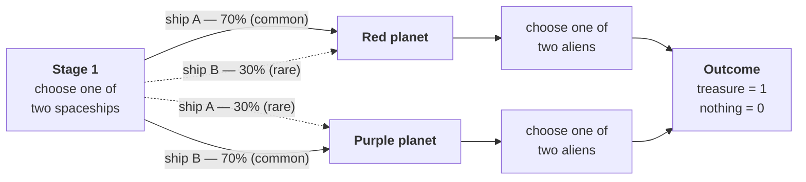

# A primer on what these papers actually do

Written for someone with a STEM/software background who has not spent time in
statistics or computational psychiatry. It assumes you are comfortable with state
machines, pseudocode and the idea of fitting parameters; it does not assume you know
what an "interaction" or a "factor analysis" is. No derivations.

Read this before [`docs/compatibility.md`](docs/compatibility.md) — the compatibility
verdict only makes sense once you know what is being compared.

---

## 1. The question

There are two very different ways to make a decision.

**Replay what worked.** Keep a running score for each action; when something pays off,
raise its score; pick high-scoring actions. Cheap, fast, needs no understanding of how
the world works. This is called **model-free** control, and it is what we colloquially
call habit.

**Simulate forward.** Keep a model of what leads to what, and at decision time think
through the consequences: "if I do X, I'll end up in state Y, and Y is currently
worth a lot". Flexible, but expensive — you have to actually do the search. This is
**model-based** control, or goal-directed behaviour.

A cached lookup table versus a forward search over a world model. Both are useful, and
people use a mixture of the two.

The clinical interest is that several psychiatric conditions look like over-reliance on
the cached version: obsessive-compulsive disorder, addiction, binge eating — behaviour
that persists even when the person knows it is not achieving anything. If you could
*measure* an individual's mix of the two systems, you would have a quantitative handle
on that idea. All three papers here use the same task to do exactly that.

## 2. The task, as a state machine

Every paper in this repository uses the **two-step task** (Daw et al., 2011). One
trial, in the spaceship cover story Kool et al. use:



So: two choices per trial, and a binary payoff. Each spaceship has a planet it
*usually* goes to (70%) and one it *occasionally* goes to (30%). The four aliens each
pay out with their own probability. Repeat ~200 times.

Two design details that look like noise but are the entire point:

* **the 30% "rare" transitions** — these are what make the two strategies
  distinguishable (section 3);
* **the alien payout probabilities drift continuously** — each wanders up and down by
  a small random amount every trial, bounded to the range 0.25–0.75. So there is no
  fixed right answer to memorise; you have to keep tracking which alien is currently
  good. Without this, everyone would converge on one choice and there would be nothing
  left to measure.

## 3. Why the rare transitions are the whole trick

Here is the one piece of reasoning the whole literature rests on. Suppose on the last
trial you picked **ship A**, were unexpectedly taken to the **purple** planet (a rare
transition — A usually goes to red), and **got treasure** there.

What should you do now?

| strategy | reasoning | next choice |
|---|---|---|
| **model-free** | "Ship A was rewarded. Do ship A again." Ship A's cached score went up; *how* the reward happened is not represented at all. | **stay** with A |
| **model-based** | "The treasure is on the purple planet. Ship A only reaches purple 30% of the time. Ship **B** goes there 70% of the time." | **switch** to B |

The two strategies make **opposite** predictions — and only after a rare transition.
After a *common* transition both say "stay". That is the dissociation: you learn
nothing from the common trials and everything from the rare ones, which is why the
task deliberately wastes 30% of its trials on them.

Turn this into a measurement over the four possible cases:

| previous trial | model-free learner | model-based learner |
|---|---|---|
| rewarded, common | stay | stay |
| rewarded, **rare** | stay | **switch** |
| unrewarded, common | switch | switch |
| unrewarded, **rare** | switch | **stay** |

A model-free learner's behaviour depends only on the reward column. A model-based
learner's depends on the *combination*. Everything else in these papers is a way of
quantifying where a given person sits between those two tables.

## 4. Measurement 1: the stay/switch analysis

The direct approach. For each person compute four numbers — the probability they
repeated their stage-1 choice, split by whether the previous trial was rewarded and
whether its transition was common or rare:

```
P(stay | rewarded, common)      P(stay | rewarded, rare)
P(stay | unrewarded, common)    P(stay | unrewarded, rare)
```

Then two summaries, which in this repo are the `mf_index` and `mb_index` columns of
`data/processed/twostep_subjects_harmonized.csv`:

* **`mf_index`** = (effect of reward, averaged over transition types)
  = `(rewarded_common + rewarded_rare) − (unrewarded_common + unrewarded_rare)`.
  In words: *does being rewarded make you repeat your choice?* Statisticians call this
  a **main effect**. It is the model-free signature.

* **`mb_index`** = `(rewarded_common + unrewarded_rare) − (rewarded_rare + unrewarded_common)`.
  In words: *does the effect of reward depend on how you got there?* This is an
  **interaction** — the thing you compute when you suspect two variables matter
  jointly rather than separately. It is the model-based signature.

That is all "main effect" and "interaction" mean here: one is an average difference,
the other is a difference of differences. No model of learning is involved — just
counting — which is exactly why this measure is comparable across datasets. Our own
output shows that holding up:

| dataset | subjects | trials | mean `mb_index` |
|---|---|---|---|
| Kool, Daw paradigm | 206 | 125 | **+0.095** |
| Gillan, study 1 | 649 | 200 | **+0.100** |
| Gillan, study 2 | 1712 | 200 | **+0.093** |

Three independent samples, different years, different labs, different trial counts —
and the same answer to two decimal places. (The `mf_index` is *not* as stable: +0.13
for Kool against +0.22/+0.24 for Gillan, which is the kind of difference 125 vs 200
trials can produce.)

The papers run this as a logistic regression — predicting the binary stay/switch
outcome from reward, transition and their interaction, with each subject allowed their
own baseline. Same quantity, computed in a way that handles unequal trial counts and
gives you error bars.

## 5. Measurement 2: fitting a reinforcement-learning model

The richer approach: write down an agent that could have produced the data, then find
the parameter values that make it behave most like the person in question. The
agent is a weighted blend of the two strategies — a **hybrid** model:

```text
# state: Q_mf[action]           cached value of each stage-1 ship (model-free)
#        Q_2[state][action]     learned value of each alien
#        T[ship] -> planet      the 70/30 transition structure

for each trial:

    # --- model-based: look ahead through the transition model ---
    Q_mb[ship] = 0.7 * best_value(T[ship])  +  0.3 * best_value(other_planet)

    # --- blend the two, w = 1 is pure planning, w = 0 is pure habit ---
    Q[ship] = w * Q_mb[ship] + (1 - w) * Q_mf[ship]
            + stickiness * (ship == last_ship)      # pure repetition bias

    # --- choose probabilistically: higher beta = more deterministic ---
    choice = softmax(beta * Q)

    # --- learn from what happened ---
    observe planet, alien choice, reward
    Q_2[planet][alien] += alpha * (reward - Q_2[planet][alien])          # alien value
    Q_mf[ship]         += alpha * (Q_2[planet][alien] - Q_mf[ship])      # one step back
    Q_mf[ship]         += alpha * lambda * (reward - Q_2[planet][alien]) # credit the
                                                                         # ship for the
                                                                         # final reward
```

The free parameters, and what moving each one does:

| parameter | what it controls | high value means |
|---|---|---|
| **`w`** (also written ω, omega) | the blend of planning vs habit | plans ahead; `w = 0` is pure habit |
| `alpha` (α) | learning rate | forgets old evidence fast, tracks recent outcomes |
| `beta` (β) | inverse temperature — choice determinism | always takes the current best; low `beta` is near-random |
| `lambda` (λ) | eligibility trace | lets the final reward update the *first*-stage choice directly, not just the alien |
| `stickiness` (π) | repetition bias | repeats the previous choice regardless of outcome |

`w` is the headline number. All three papers report some version of it.

Worth knowing: `beta` and `w` are entangled. Someone who chooses almost at random has
a low `beta`, and their `w` is then poorly determined — there is little signal to infer
it from. This is one reason per-subject estimates from a 125-trial session are noisy,
and why the simple counting measure in section 4 is often the more robust choice.

## 6. What "fitting" means here

For one subject, the model with a given parameter set assigns a probability to each
choice they made. Multiply those together over all ~200 trials and you get the
**likelihood**: how probable this person's actual choice sequence is under those
parameters. Fitting = searching parameter space to maximise it. Mechanically it is just
numerical optimisation over 5–7 bounded parameters.

With only 200 trials, raw maximum likelihood overfits — it will happily return
`w = 0.97` or `beta = 19` on the strength of a few lucky trials. So everyone
regularises, and **the three papers regularise differently**:

| approach | what it does | the software analogy |
|---|---|---|
| **MAP with a prior** (Kool) | adds a penalty pulling each parameter toward a sensible prior range | a fixed regularisation term, chosen in advance |
| **Hierarchical / EM** (Gillan) | estimates the group distribution and each individual jointly, pulling outliers toward the group | regularisation whose strength is *learned from the data*, so each subject's estimate depends on the rest of the sample |
| not stated (Gilger) | — | — |

Both are shrinkage: individual estimates get pulled toward a centre. That is good
practice and it is also why you cannot compare the outputs across papers — see the
next section.

## 7. Why the three papers' numbers can't be compared

This is the main practical finding of this repository, and it has two independent
causes.

**Different model.** Kool and Gilger fit a `w` between 0 and 1 that splits behaviour
between the two systems. Gillan's model (following Otto et al., 2013) has **no `w` at
all** — it gives the model-based and model-free value estimates *separate, unbounded*
weights, `beta_MB` and `beta_MF`. There is no conversion between "`w` = 0.4" and
"`beta_MB` = 1.5"; they are not the same kind of quantity. Gilger's version has seven
parameters (separate learning rates and temperatures per stage) where Kool's has six
(one each, plus two stickiness terms).

**Different regularisation.** Even fitting the *same* model, MAP-with-a-prior and
hierarchical EM return different numbers for the same subject, because they shrink
toward different places — and in the hierarchical case, toward a centre that depends on
whoever else was in the sample.

Add that trial counts differ (125 / 200 / 201), and three published `w`-like numbers
are three different measurements. So:

* **comparing across datasets?** Use the counting measure from section 4 — it is
  already in `twostep_subjects_harmonized.csv` and needs no model.
* **want model parameters anyway?** Refit **one** model with **one** estimator to all
  the harmonized trial data. That is what `twostep_trials_harmonized.csv` is built for;
  its `s2_choice_global` column is already in the encoding the standard `ts_par7`
  implementation expects.

## 8. What each paper did with the task

### Kool, Cushman & Gershman (2016) — does planning actually pay off?

An economic question rather than a clinical one: if model-based control is so much
work, what does it buy you? They show that in the *standard* two-step task, planning
earns you barely any extra reward — so a rational agent economising on effort would not
bother, and the widely-reported finding that people are "only partly model-based" may
be a sensible response to a task with a weak incentive rather than a cognitive
limitation.

They then **redesign** the task so planning genuinely pays: deterministic transitions,
a single second-stage action, and scalar point rewards instead of a coin flip. That is
the `novel paradigm` in this repo. People become markedly more model-based in it — in
the authors' own fits, mean `w` rises from **0.35** in the standard task to **0.50** in
the redesigned one.

That redesign is also why `kool_novel` **cannot be pooled** with the other datasets.
With deterministic transitions there are no rare trials, so the entire section-3 logic
is unavailable and the model-based index is undefined — it comes out as `nan` in our
output, correctly.

### Gillan, Kosinski, Whelan, Phelps & Daw (2016) — mapping it onto symptoms

Scale instead of a lab: ~2000 people online (Amazon Mechanical Turk), each doing 200
trials plus a battery of nine psychiatric questionnaires (OCD, depression, anxiety,
alcohol use, eating disorders, impulsivity, schizotypy, apathy, social anxiety).

The obstacle is that those questionnaires overlap heavily — depression and trait
anxiety scores correlate at 0.81 — so "is it depression or anxiety that predicts this?"
is close to unanswerable from total scores. Their fix is a **factor analysis** (next
section), which reduces 209 individual questionnaire items to three underlying
dimensions. One of them — **Compulsive Behaviour and Intrusive Thought**, drawing on
OCD, eating-disorder and addiction items — is reliably associated with *reduced*
model-based control. Depression and anxiety are not.

### Gilger et al. (2024) — can you move it with a drug?

The causal question, and Marina's starting point. Serotonin had been implicated in this
balance, so: manipulate it and see. 98 participants did the task three times inside an
MRI scanner (88 of them with usable scans), once under tryptophan **loading**, once
**balanced**, once **depletion** — tryptophan is the dietary precursor of serotonin.
Double-blind, crossover, so each person is their own control.

The answer was no: neither model-based nor model-free control shifted detectably, and
neither did the brain response. A careful null result.

## 9. Factor analysis, briefly

You have a 1413 × 209 matrix of questionnaire answers. The columns are massively
redundant — many items are near-paraphrases. Factor analysis asks: can the pattern of
correlations be explained by a small number of unobserved variables?

If you know PCA, it is close relative: find a low-dimensional structure that accounts
for most of the covariance, then interpret the axes by looking at which items load most
heavily on each. Gillan et al. found three dimensions and named them from their top
items: **Anxious-Depression**, **Compulsive Behaviour and Intrusive Thought**, and
**Social Withdrawal**.

The useful artefact is that they published the **scoring matrix** — 209 items × 3
factors — as `weights.csv`. Standardise your item responses, multiply by that matrix,
and you get the same three dimensions *for a new sample*, without refitting anything.
We verified the recipe reproduces their published scores at r = 0.9992
([`docs/codebook_gillan.md`](docs/codebook_gillan.md)). If you want to place your own
participants on the Gillan dimensions, that is the route.

## 10. Glossary

| term | meaning |
|---|---|
| **model-free** | choosing from cached action values; habit |
| **model-based** | choosing by searching forward through a learned model of the world; goal-directed |
| **two-step task** | the task in section 2; the standard instrument for separating the two |
| **common / rare transition** | the 70% / 30% outcomes of a stage-1 choice |
| **stay probability** | how often someone repeats their previous stage-1 choice |
| **main effect** | an average difference (here: of reward on staying) |
| **interaction** | a difference of differences — whether one variable's effect depends on another. The model-based index |
| **TD learning** | temporal-difference: nudge a stored value toward the newly observed one. The `+= alpha * (new - old)` line |
| **learning rate (α)** | how big that nudge is |
| **eligibility trace (λ)** | how much a final reward also updates the *earlier* choice in the trial |
| **softmax / inverse temperature (β)** | turns values into choice probabilities; high β = near-deterministic |
| **stickiness / perseveration (π)** | tendency to repeat the last choice regardless of outcome |
| **likelihood** | the probability a model assigns to the data actually observed |
| **MAP** | maximum a posteriori: maximum likelihood plus a prior that penalises implausible parameters |
| **EM / hierarchical fitting** | fitting individuals and the group distribution together, so each estimate is shrunk toward the group |
| **shrinkage** | pulling individual estimates toward a centre to avoid overfitting; regularisation |
| **random walk** | a value that drifts by a small random step each trial — how the alien payoffs move |
| **MTurk** | Amazon Mechanical Turk, an online task-work platform used for large samples |
| **within-subject crossover** | every participant does every condition, so each is their own control |
| **factor analysis** | reducing many correlated measures to a few underlying dimensions |

## 11. Where to go next

| to understand | read |
|---|---|
| whether the datasets can be combined | [`docs/compatibility.md`](docs/compatibility.md) |
| what every column in Kool's `data.mat` means | [`docs/codebook_kool.md`](docs/codebook_kool.md) |
| what every column in Gillan's OSF files means | [`docs/codebook_gillan.md`](docs/codebook_gillan.md) |
| the model behind Gilger's published parameters | [`docs/codebook_gilger.md`](docs/codebook_gilger.md) |
| the combined cross-dataset table | [`docs/codebook_harmonized.md`](docs/codebook_harmonized.md) |
| whether any of this is trustworthy | [`docs/validation_report.md`](docs/validation_report.md) |
| the original papers and data | [`sources/README.md`](sources/README.md) |

### Primary references

* Daw ND, Gershman SJ, Seymour B, Dayan P, Dolan RJ (2011). Model-based influences on
  humans' choices and striatal prediction errors. *Neuron* 69:1204–1215. — the task and
  the 7-parameter model everything here descends from.
* Kool W, Cushman FA, Gershman SJ (2016). When does model-based control pay off?
  *PLoS Comput Biol* 12:e1005090.
* Gillan CM, Kosinski M, Whelan R, Phelps EA, Daw ND (2016). Characterizing a
  psychiatric symptom dimension related to deficits in goal-directed control.
  *eLife* 5:e11305.
* Gilger MD et al. (2024). Arbitration between model-free and model-based control is
  not affected by transient changes in tonic serotonin levels.
  *J Psychopharmacol* 38:178–187.
* Otto AR, Gershman SJ, Markman AB, Daw ND (2013). The curse of planning.
  *Psychol Sci* 24:751–761. — the simplified model Gillan et al. fit.
